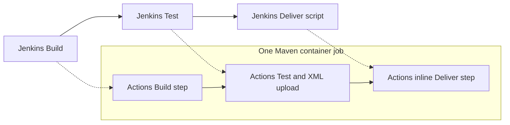

# 🚀 Jenkins to GitHub Actions Migration Report

## 📊 Migration Overview

| Metric | Before (Jenkins) | After (GitHub Actions) |
| --- | --- | --- |
| Pipeline Files | 1 Jenkinsfile and 1 delivery script | 1 workflow |
| Pipeline Stages | 3 sequential stages | 1 job with sequential Build, Test, and Deliver steps |
| Pipeline Steps | 3 shell invocations and 1 JUnit publisher | 6 steps including checkout and Maven caching |
| Shared Libraries | 0 | None to expand |
| Credentials | 0 explicit credentials | 0 configured secrets or variables |

Source: `jenkins/Jenkinsfile` and `jenkins/scripts/deliver.sh`.
Destination: [`.github/workflows/maven.yml`](../workflows/maven.yml).
The migration follows Source, Analyze, Convert, Validate, and Document in order.
The requested plugin agent was invoked but its tool access was blocked; the
migration was subsequently completed directly using the `migration-core`,
`jenkins-migration`, and `actionlint` skills.

## 🔄 Conversion Diagram



## 🔧 Key Transformations

### Stage and Step Conversions

- Retained `maven:3.9.0` as the job container on `ubuntu-latest`.
- Kept all stages in one job to preserve the shared workspace, built JAR, and
  local Maven repository without introducing inter-job artifact transfers.
- Build runs the original `mvn -B -DskipTests clean package`.
- Test runs the original `mvn test`.
- The Test stage's `post { always { junit ... } }` becomes an artifact upload
  with `always()` whenever Test was not skipped. Missing XML fails publication,
  and failed tests still prevent Deliver.
- Inlined the original delivery operations: install the JAR locally, evaluate
  the project name and version, and run `java -jar`. Used Maven's
  `-q -DforceStdout` instead of filtering human-readable logs, and quoted the
  resulting path. Bash fail-fast behavior prevents hiding a failed Maven command.
- Omitted the script's Jenkins-specific explanatory echo statements and tracing;
  the application output remains visible in workflow logs.

### Shared Library Expansions

No shared libraries, included pipelines, parallel stages, matrices, or external
deployment integrations exist in the source. The referenced delivery script is
fully expanded inline; the archived script is not executed by the workflow.

### Credential and Environment Mappings

No Jenkins credentials, credential bindings, or custom environment variables
were present. No secrets or GitHub configuration variables need to be created.
Checkout uses GitHub's automatically supplied token with `contents: read`;
credential persistence is disabled.

### Structural Changes

- No trigger is defined in the Jenkinsfile, so the workflow uses only
  `workflow_dispatch`. It does not add push, PR, or scheduled execution.
  External Jenkins UI/webhook configuration was not supplied and cannot be inferred.
- Replaced the host `/root/.m2` bind mount with `actions/cache` for the same
  container path. Keys include the POM hash and run identity, restoring the
  latest matching cache and saving successful runs, including locally installed
  application artifacts.
- Jenkins JUnit trend charts and parsed test views are not reproduced:
  `junit-reports` contains the original XML for download, while Maven logs and
  step status show test success or failure. This avoids an unverified publisher
  or a custom reporting integration.

## ✅ Validation Results

### Linting Results

Actual final command: `actionlint .github/workflows/*.yml`

```text
No issues found
```

The command produced zero stdout/stderr and exited with status 0, using
actionlint 1.7.12 with ShellCheck available.

### Manual Verification Checklist

- [x] YAML syntax and workflow expressions validated by actionlint.
- [x] All action references pinned to verified commit SHAs.
- [x] Build, Test, publication, and Deliver ordering reviewed.
- [x] Original container and Maven build/test commands retained.
- [x] No user-configured secrets or variables required.
- [x] Delivery script expanded inline; no shared libraries or parallel stages.
- [x] Manual trigger matches the absence of triggers in the source file.
- [x] Both originals archived byte-for-byte and removed from original paths.
- [x] Build, Test, and inline Deliver commands executed successfully in a local
  `maven:3.9.0` container.
- [x] JUnit XML confirmed 2 tests, 0 failures, 0 errors, and 0 skipped.
- [x] Delivery completed local Maven installation and printed `Hello World!`.

Local execution used Docker on macOS/ARM64. GitHub-hosted execution, artifact
service integration, and cache restore/save remain to be confirmed by the first
manual run on GitHub after merge; no hosted run is claimed here.

## 🔐 Security Improvements

Only GitHub-owned `actions/*` actions are used. Each is SHA-pinned and annotated
with its release version; the workflow token has only `contents: read`.
No credential values appear in the workflow or this report. No new security
scanners, deployment permissions, or protected environments were introduced.

| Action | Version | Verified commit |
| --- | --- | --- |
| `actions/checkout` | v7.0.1 | `3d3c42e5aac5ba805825da76410c181273ba90b1` |
| `actions/cache` | v6.1.0 | `55cc8345863c7cc4c66a329aec7e433d2d1c52a9` |
| `actions/upload-artifact` | v7.0.2 | `cf430e030ddbb5b0abf93d22962f4752f3646cd9` |

The shipped catalog was resolved on 2026-09-18 and was not stale at migration
time (2026-10-23). GitHub API latest-release and commit lookups confirmed the
checkout/cache pins and supplied the newer upload-artifact v7.0.2 pin.

## 📈 Performance Enhancements

Maven dependencies are cached to replace the original host volume. Sequential
execution avoids re-checkout or JAR transfer between isolated jobs. No speedup
measurement is claimed, and no parallelism was added.

Unlike the mutable Jenkins volume, Actions caches are immutable, branch-scoped,
subject to eviction, and saved only after a successful job. Dependency downloads
and local installation can recur after a cache miss; the cache is not a durable
package registry.

## 🔗 Variable and Secret Requirements

### Required GitHub Secrets

None to configure. GitHub automatically supplies the checkout token; it is not
a new repository secret.

### Required GitHub Variables

None. The source contains no configurable credentials or environment values.

## 🎯 Next Steps

1. Merge this PR into `master` so GitHub can register the manual workflow.
2. Run **Actions > Maven build, test and deliver > Run workflow** and confirm
   the logs, `junit-reports` download, and cache behavior.
3. Confirm whether any triggers exist outside the supplied Jenkinsfile before
   disabling the old Jenkins job. Disable that job after successful cutover.
4. Account for the documented JUnit UI and cache-lifetime differences in team
   operations. No secrets, external registries, or environments need setup.

## 📁 Original Jenkins Files

The originals were moved, not left active:

| Original | Archived copy |
| --- | --- |
| `jenkins/Jenkinsfile` | [`jenkins/Jenkinsfile`](jenkins/Jenkinsfile) |
| `jenkins/scripts/deliver.sh` | [`jenkins/scripts/deliver.sh`](jenkins/scripts/deliver.sh) |

## 📚 Migration Notes

Deliver means installation into the container's local Maven repository followed
by running the executable JAR, not external deployment or artifact publication.
The application, POM, and unrelated CloudBees workflow are unchanged. README
instructions now point to Actions and the archived Jenkins sources.

This branch also contains its inherited migration-tooling setup commit, which
adds `.github/copilot/settings.json` and `.github/github-app.yml`; those changes
are included when comparing the PR against `master`.

---
*Migration completed by GitHub Copilot using the Jenkins migration skills.*
